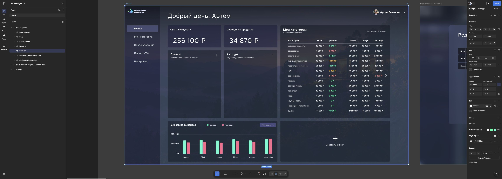
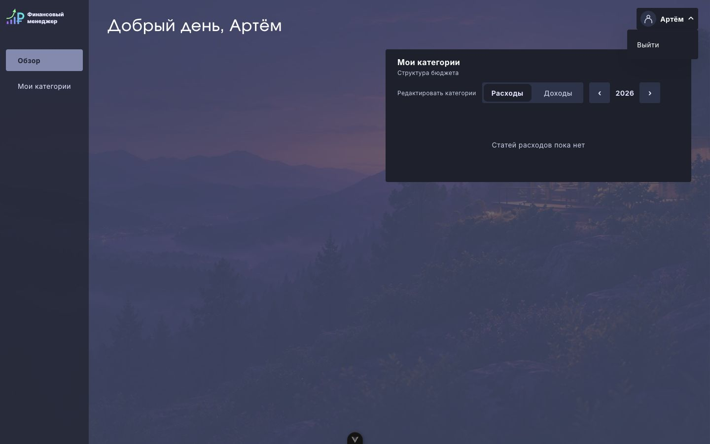
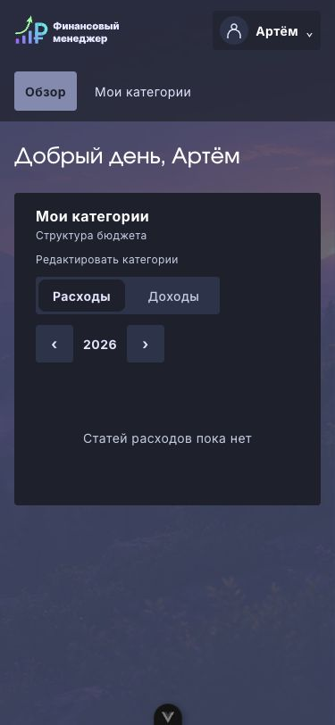
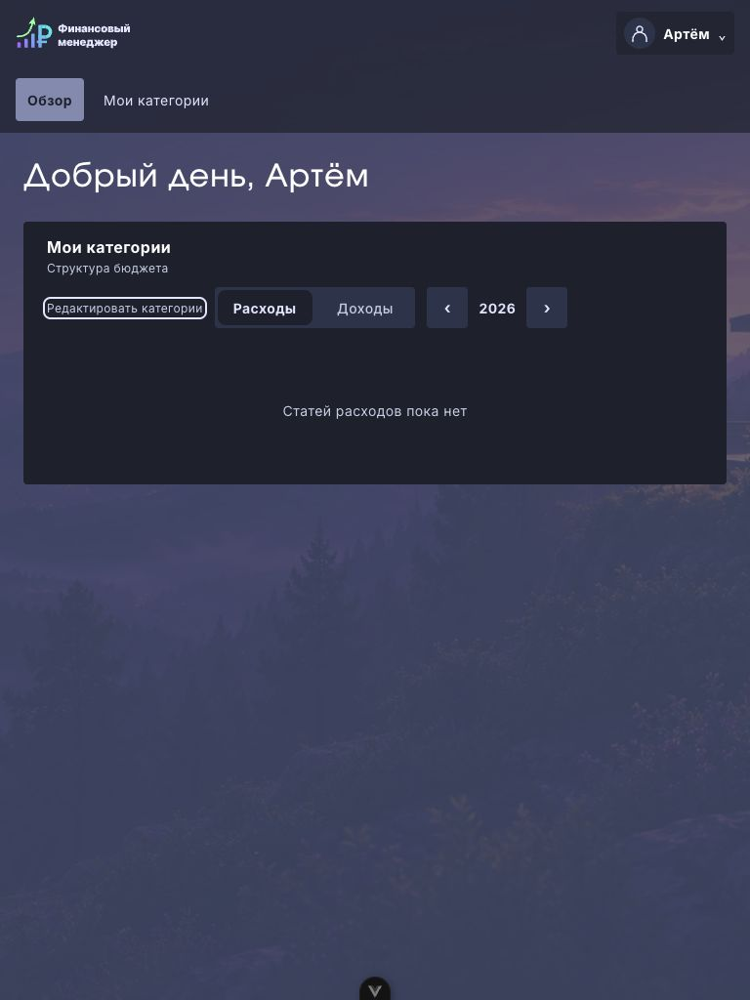
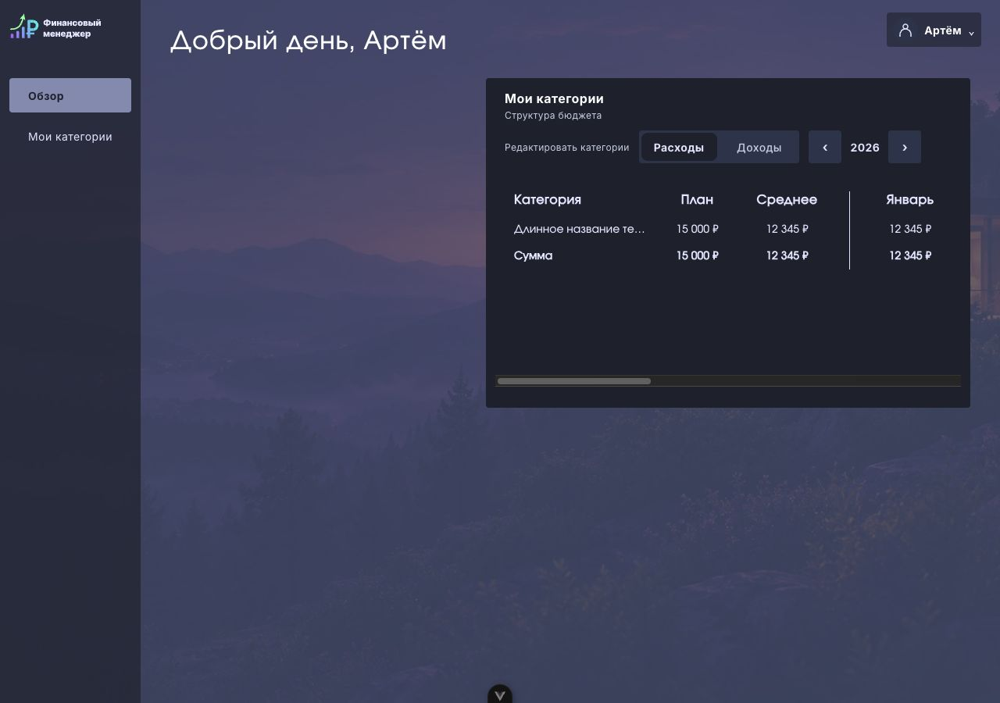
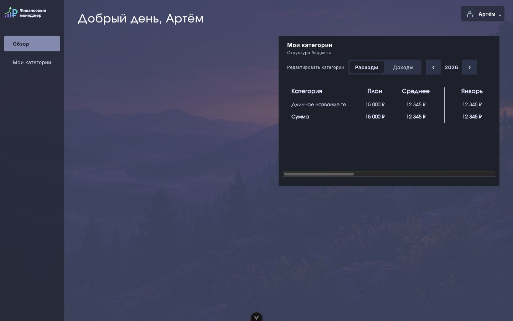
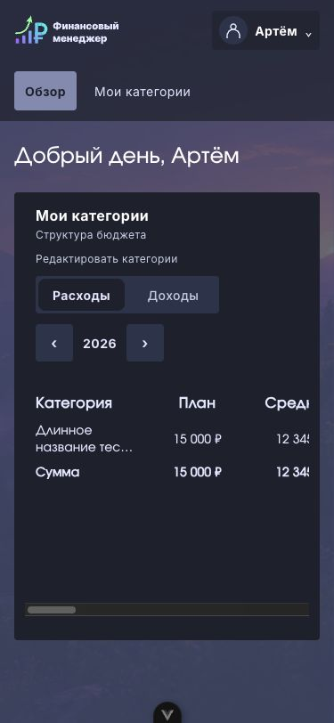
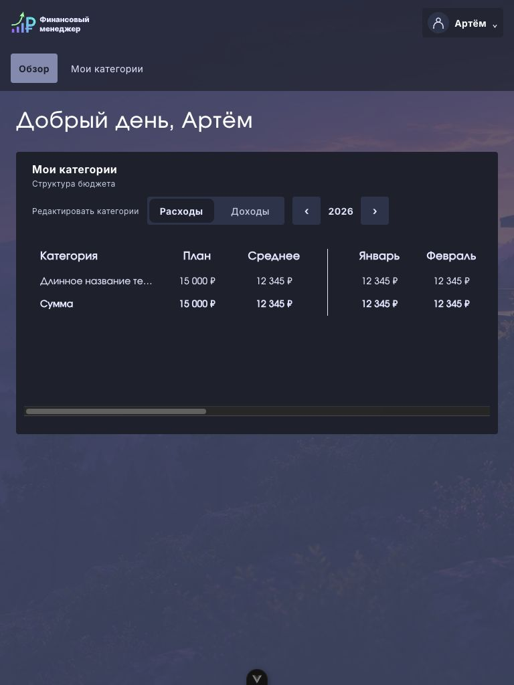

# Оболочка FM-57

Источник: Figma «Новый дизайн», [Главная 230:422](https://www.figma.com/design/FAPPJ3LrAUEY8indrAbfnV/Fin-Manager?node-id=230-422) и [меню профиля 237:1116](https://www.figma.com/design/FAPPJ3LrAUEY8indrAbfnV/Fin-Manager?node-id=237-1116). Макеты прочитаны через браузер: пользователь явно разрешил этот fallback при отсутствии MCP.

Оболочка использует ресурсы и токены FM-55: логотип, пейзаж с приглушающим слоем, шрифты и цвета. Desktop-панель — 180 CSS-px (240px макета при масштабе 0.75), основные отступы — 38px. Профиль справа сверху; нейтральный силуэт вместо отсутствующего в API аватара. Без имени подпись «Профиль», приветствие — «Добрый день».

Меню профиля — disclosure с обычной кнопкой «Выйти»: Enter/Space или ArrowDown открывают его с фокусом на выходе, Escape закрывает с возвратом фокуса. Tab свободно выходит из меню и закрывает его. Внешний pointerdown закрывает меню; фокус возвращается на триггер, а стандартное действие клика по другому контролу сохраняется.

«Мои категории» ведёт к существующей карточке на этой же странице (`/#categories`), прокручивает к ней и переводит фокус. Нереализованные сценарии и настройки профиля скрыты. Суммы и графики из Figma не подставляются. На desktop карточка категорий занимает правую колонку; левая оставлена для FM-50, которая добавит доходы/расходы и зарезервирует место сумм над ними. Внутренний дизайн таблицы и диалогов остаётся задачей их отдельного переноса.

## Адаптация и проверка

В Figma нет узких вариантов. Пользователь согласовал: ниже 1024px логотип и профиль сверху, навигация под ними; доступные блоки в одну колонку. Колонки контента разделяются от 1280px; правая не уже 620px, чтобы закреплённые столбцы не перекрывали месяцы.

14.10.2026: Chrome, 375×812, 768×1024 и 1440×900 CSS-px. На всех ширинах `scrollWidth === innerWidth`, элементы доступны. Проверены открытие профиля с клавиатуры, Escape с возвратом фокуса и Tab без ловушки. Снимки сделаны на `/dev/shell-preview.html`: это отдельный dev-стенд с пустыми ответами API, не production-вход и не демонстрационные данные в приложении. Выход и очистка сессии дополнительно покрыты интеграционными тестами с настоящими router guards.

Референс включает будущие карточки; результат показывает только реализованные блоки.

| 375 CSS-px | 768 CSS-px |
| --- | --- |
|  |  |

## Исправление по ревью

В заполненном состоянии при 1280px исходные равные колонки оставляли месяцу лишь 26px при ширине ячейки 131px. Браузерная проверка `scroll.clientWidth − сумма ширин первых трёх th >= ширина четвёртого th` сначала вернула false, после минимальной ширины правой колонки 620px — true (142px >= 131px). Это регрессия контейнера FM-57; внутренности таблицы FM-58 не менялись. NOTE(FM-57) в HomeView объясняет минимум.

Стенд `/dev/shell-preview.html?filled` предоставляет одну явно тестовую строку для проверки. Заполненное состояние проверено на 375, 768, 1280 и 1440px: горизонтальная прокрутка остаётся внутри таблицы. Длинное имя проверено на 375px — приветствие переносится, профиль сокращается без переполнения.

| 375 CSS-px | 768 CSS-px |
| --- | --- |
|  |  |
