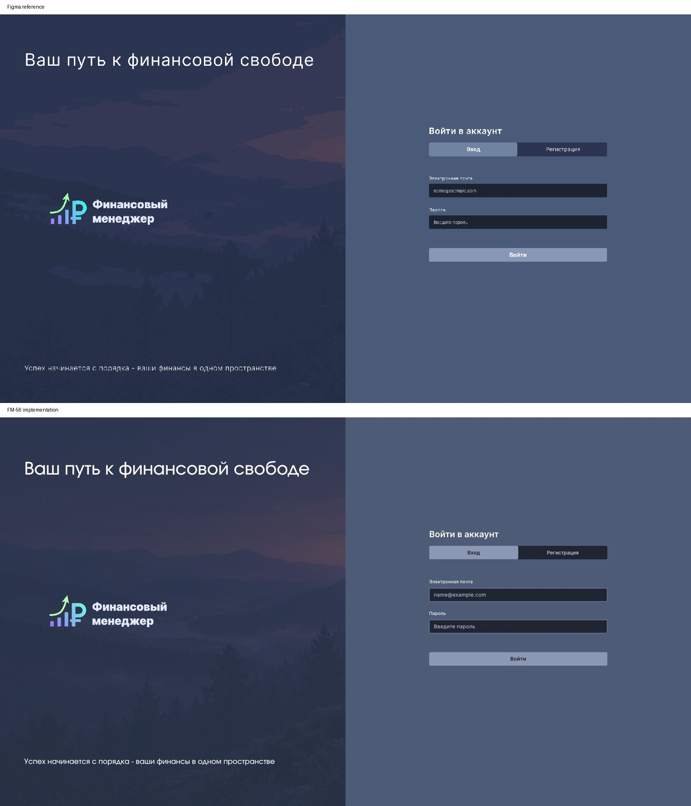
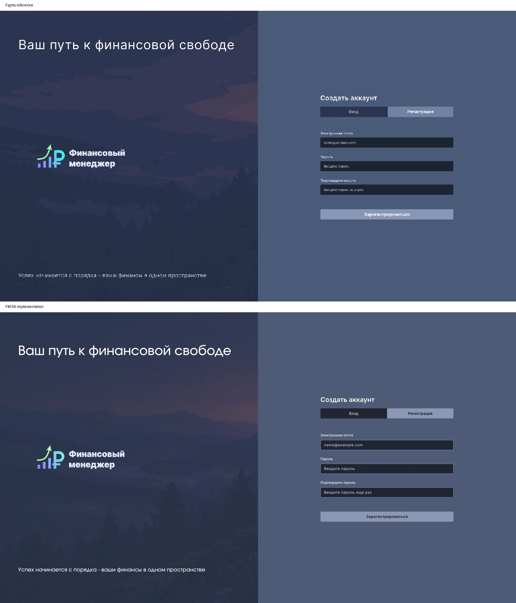
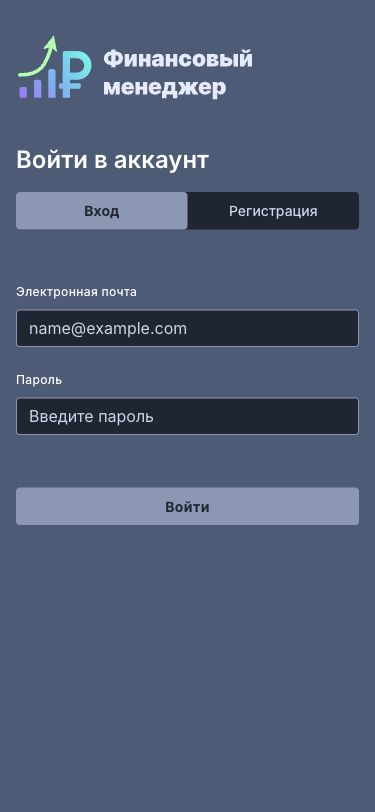
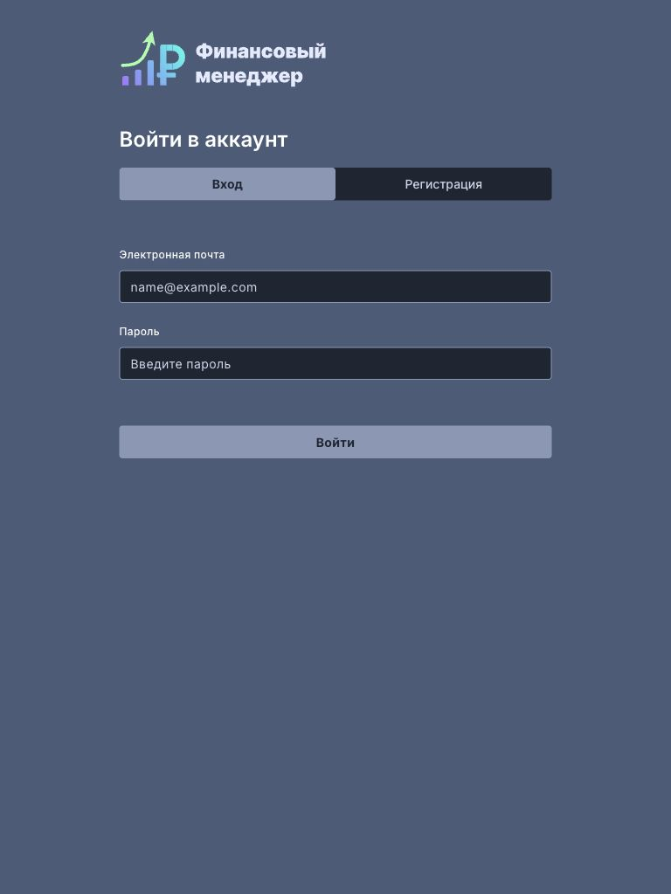
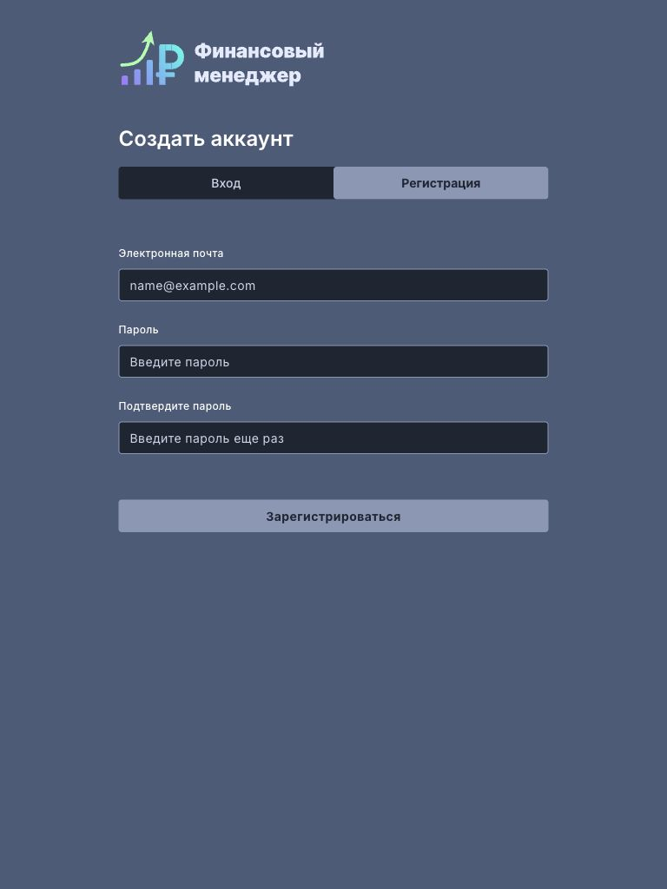
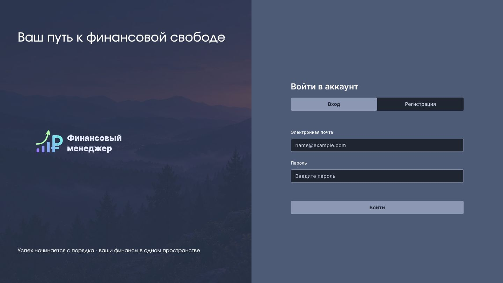
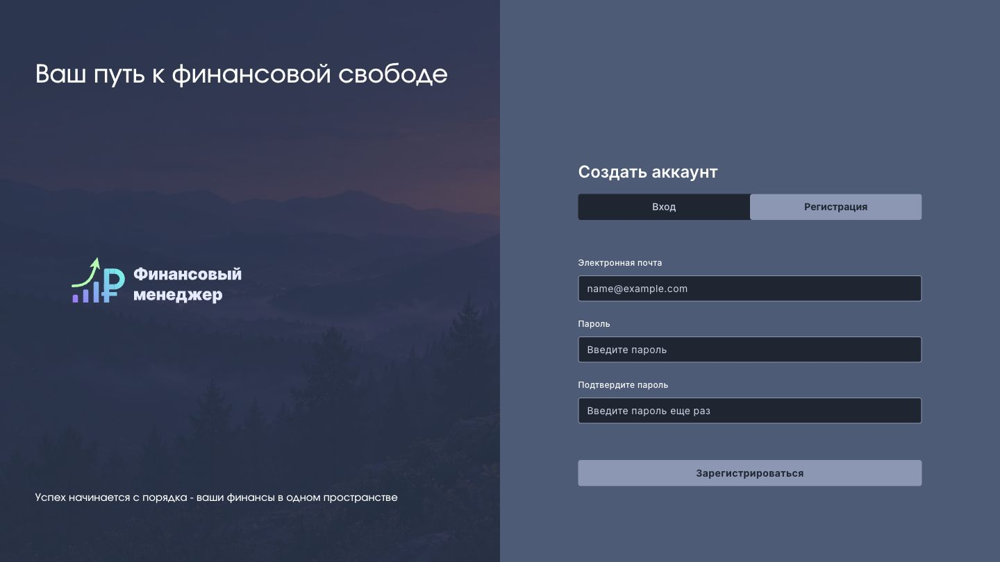
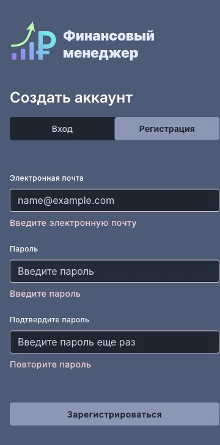

# Вход и регистрация — FM-56

Основа — FM-55, PR #12: общие компоненты, Inter, Involve Medium, фон и логотип. Сохранено согласованное тёмное начертание текста кнопок на светлой заливке; активная ссылка использует ту же пару токенов для контраста. Сохранены доступные состояния и границы полей из FM-55.

## Макеты

[Figma «Вход», 214:518](https://www.figma.com/design/FAPPJ3LrAUEY8indrAbfnV/Fin-Manager?node-id=214-518) и [«Регистрация», 220:24](https://www.figma.com/design/FAPPJ3LrAUEY8indrAbfnV/Fin-Manager?node-id=220-24). Проверены в браузере; референсы взяты из локального `screens/figma_fm.pdf` проекта fm-auto-dev, как в FM-55.

- Исходный размер 1920×1080, две равные колонки. Блок формы: x=1192, y=309.25, ширина 495; одинаковая верхняя позиция для двух режимов.
- Фон фирменной панели: Rectangle 35, #2A3B53 (`surface-brand`); изображение с непрозрачностью 20%, левая половина пейзажа.
- Заголовок, логотип и нижний слоган расположены по макету. Старые приветствия удалены. Между полями шаг 88px; ошибки увеличивают высоту формы в обычном потоке.
- На 375 и 768 px фирменную панель заменяет компактный логотип. Форма ограничена 495px, при нехватке высоты прокручивается вся страница. Это адаптация по критериям FM-54: отдельных мобильных макетов нет.

В сравнении сверху макет, снизу production-сборка; обе сняты/отрендерены при 1920×1080, затем одинаково уменьшены. Контуры шрифта в PDF отличаются от браузерного рендеринга; используется настоящий Involve Medium из FM-55.

## Проверка

- `npx eslint .`, `npm run build`, `npm run test`: успешно, 269 тестов.
- TDD: три проверки новых заголовков/переключения сначала упали на старой вёрстке; после реализации прошли.
- Проверены сохранность ввода при ошибках входа/регистрации, запрет повторной регистрации на обоих этапах (регистрация и автовход), возврат из регистрации по безопасному redirect. Существующие тесты покрывают валидацию, вход, автовход и отклонение внешнего redirect.
- Chrome, production preview: обе формы при 375×812, 768×1024, 1440×810. Горизонтального переполнения и перекрытий нет. Дополнительно 375×500 с ошибками: начало формы и кнопка доступны через прокрутку.
- Tab переводит фокус на поля, виден контур; Enter вызывает валидацию, сообщения связаны с полями. В консоли production-страницы ошибок нет.
- Реальные запросы к backend в этой визуальной проверке не выполнялись; API-сценарии проверены автотестами с моками.

| Ширина | Вход | Регистрация |
| --- | --- | --- |
| 375 |  |  |
| 768 |  |  |
| 1440 |  |  |

## Существующие ограничения

Сохранены TODO(FM-12/13): переключение режима уничтожает форму, не отменяя начатый запрос, и теряет query redirect. Это прежнее поведение, не изменение FM-56; прямой вход/регистрация с redirect по-прежнему проверяют безопасность адреса. Функциональная переработка этих сценариев не включена в редизайн.
