# FM-58 — структура бюджета

Источник: [Figma «Новый дизайн», Главная 230:422](https://www.figma.com/design/FAPPJ3LrAUEY8indrAbfnV/Fin-Manager?node-id=230-422).
Макет прочитан в браузере по разрешению пользователя вместо Figma MCP.

Карточка «Мои категории» 230:464: 742×631px; фон Rectangle 46 (230:465), #010D17 с непрозрачностью 40%. Заголовок Inter Bold 20px, группа «Колонки» 667×499px. Используются токены темы FM-55, Inter, компактные денежные ячейки с табличными цифрами и разделитель под заголовками. Ширина карточки задаётся оболочкой FM-57.

Сохранены адаптации FM-28/FM-43: выбор типа и года, состояния без данных, все 12 месяцев через внутреннюю прокрутку, непрозрачные закреплённые колонки и жирный итог, высота таблицы 250–500px. Поверхность таблицы непрозрачна, чтобы при прокрутке ячейки не просвечивали друг через друга. Отдельных макетов узких экранов и состояний нет; существующие переносы управляющих элементов сохранены в теме FM-55. Цветовое сравнение плана и факта остаётся за пределами задачи (существующий TODO FM-28).

Нулевые суммы остаются «0 ₽»; разные причины прочерка доступны скринридеру и в подсказке при наведении. Область таблицы фокусируется Tab и прокручивается стрелками. Кнопка редактора явно получает фокус до открытия окна, включая браузеры, которые не фокусируют кнопки мышью.

## Проверка

Стенд: `npm run dev -- --port 5188`, `/dev/budget-preview.html`. Данные фиксированы, backend и localStorage не используются. Параметры: `?dense` — 25 строк, `?empty`, `?error` — ошибка первого запроса с успешным повтором, `?loading` — задержка 3 секунды. Стенд не является production entrypoint.

Текст всех ячеек (суммы, средние, план и причины отсутствия значений) на одинаковых данных совпал до и после редизайна. Автотесты сохраняют проверки 12 месяцев, смены типа/года, границ годов, устаревших запросов, ошибки/повтора, пустых данных, обновления после сохранения категорий и закрепления колонок/итогов. Новые тесты написаны и выполнены с ожидаемым падением до реализации: клавиатурная область прокрутки, подсказки для null и фокус кнопки редактора.

## Сравнение

| Ширина | До | После |
| --- | --- | --- |
| 375 | 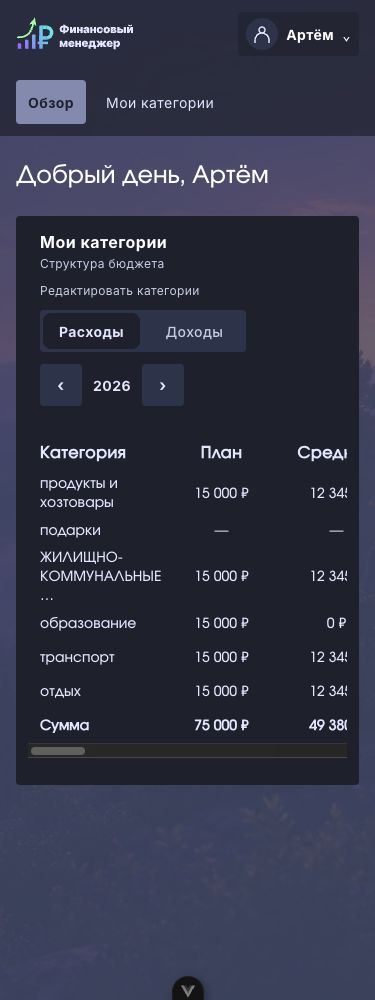 | 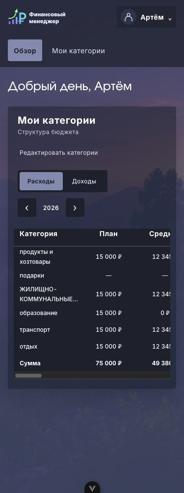 |
| 768 | 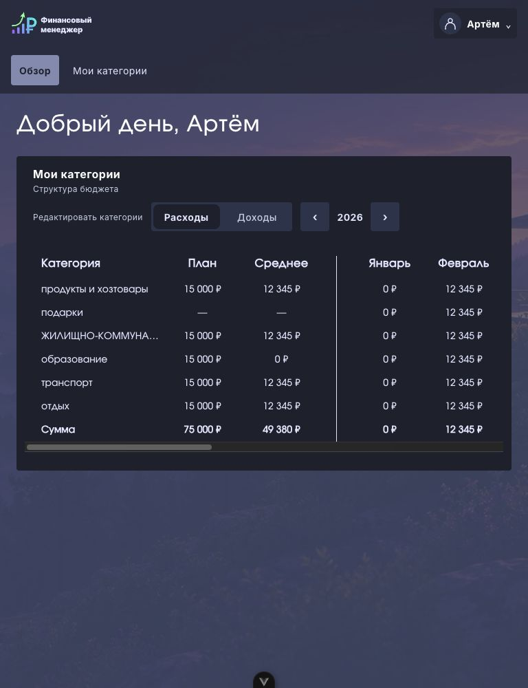 | 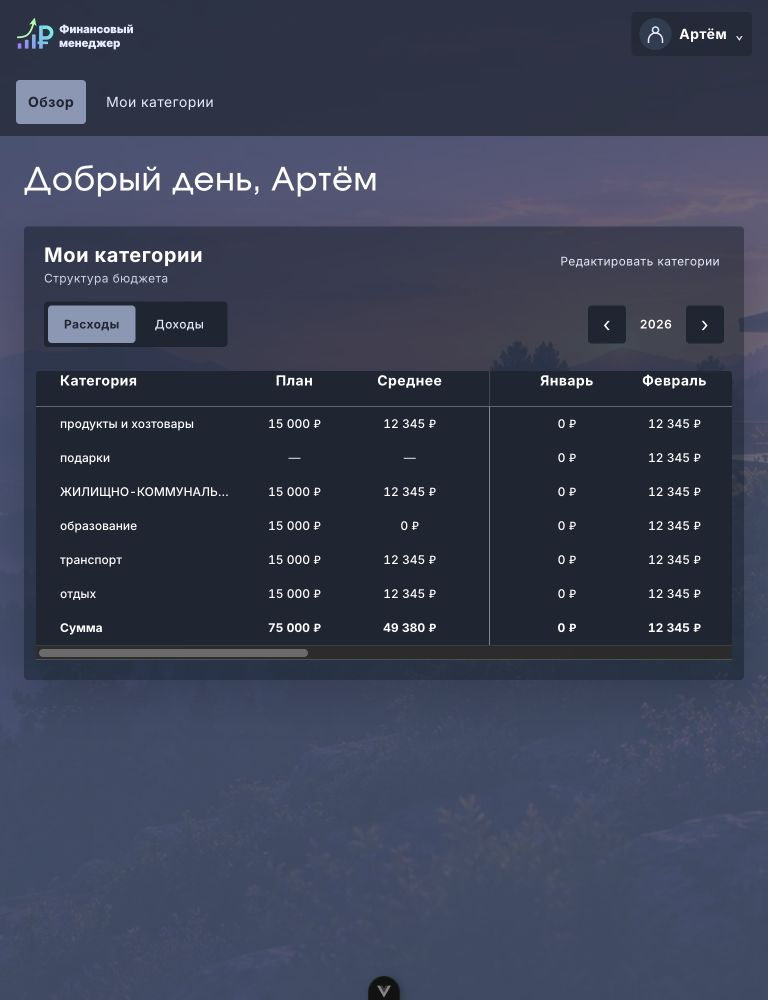 |
| 1440 | 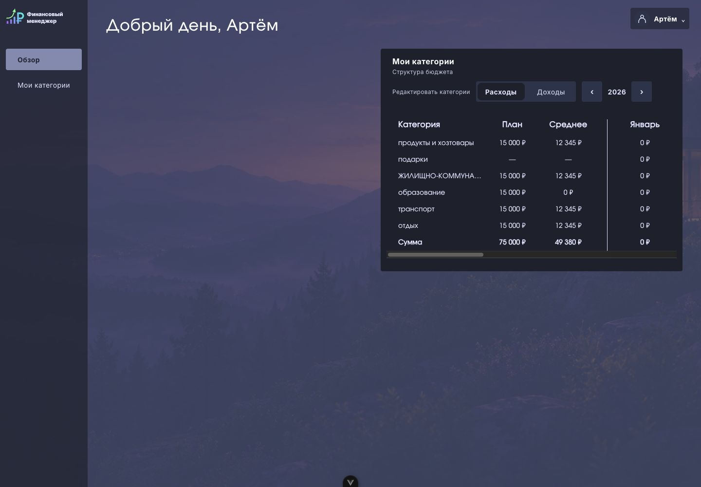 | 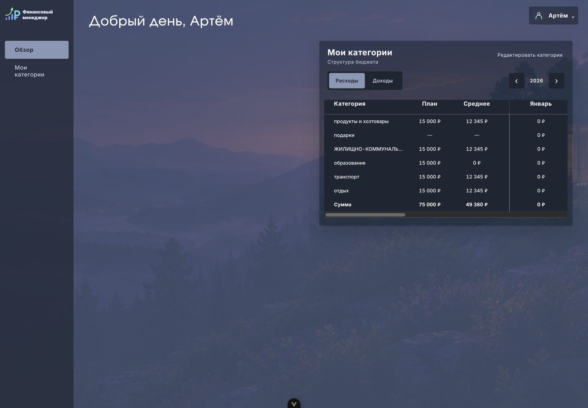 |

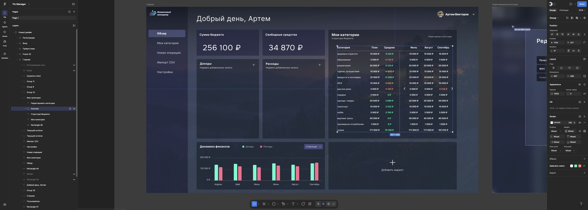

## Ручные результаты

14.10.2026: 375px проверено в Chrome; 768/1440px — во встроенном Chromium после потери соединения с Chrome. На всех ширинах `scrollWidth` страницы равен ширине viewport. При 25 строках проверены оба направления прокрутки: достигнут правый край декабря, категория остаётся на левом краю, итог — над горизонтальной полосой. Стрелки клавиатуры меняют `scrollLeft` у фокусированной таблицы. Ошибка → «Повторить» возвращает таблицу; состояния загрузки и пустого списка читаемы. Обновление после сохранения редактора проверено компонентным тестом.

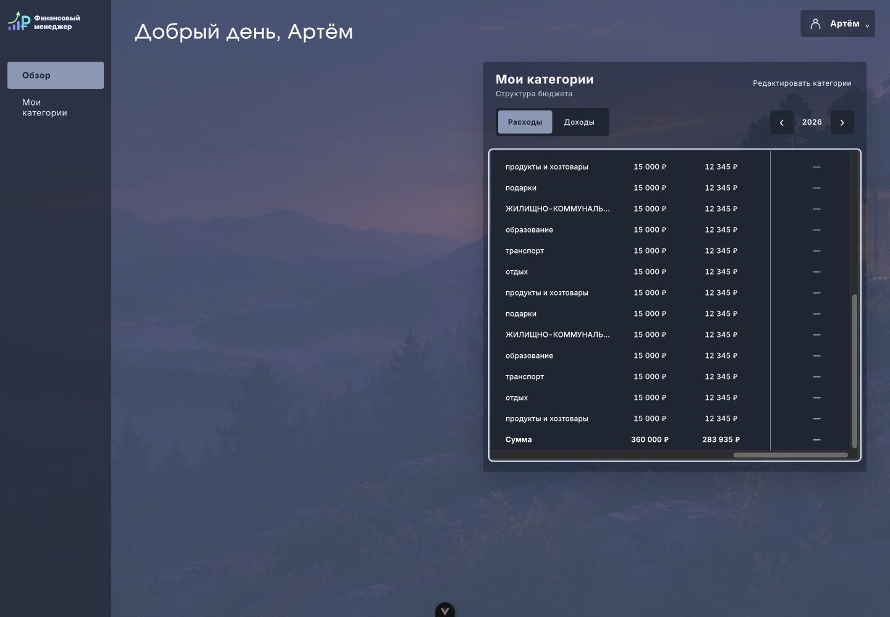
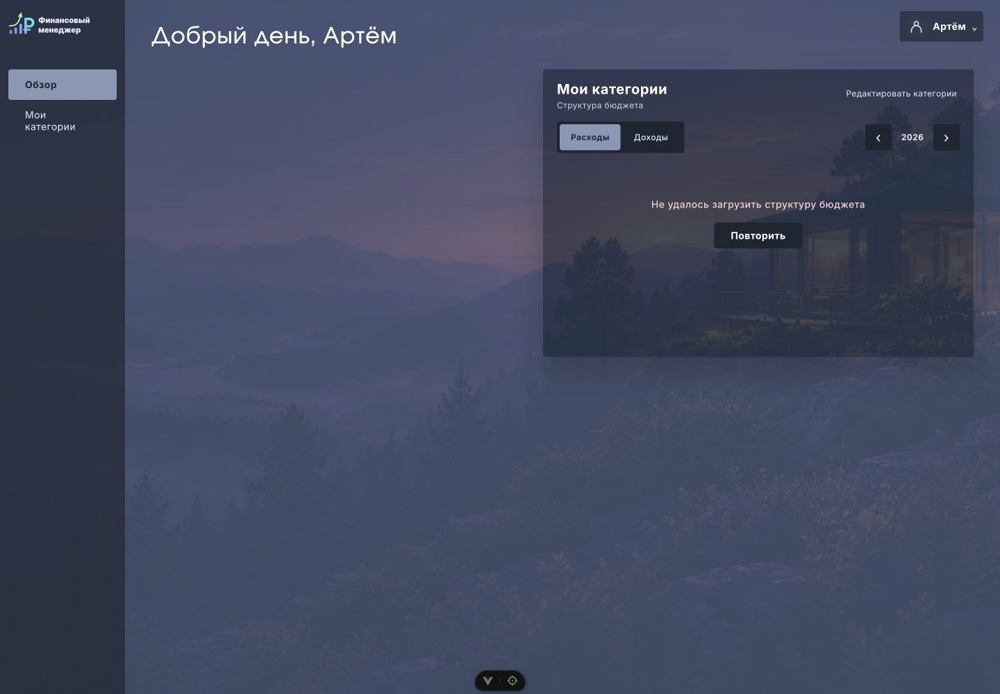
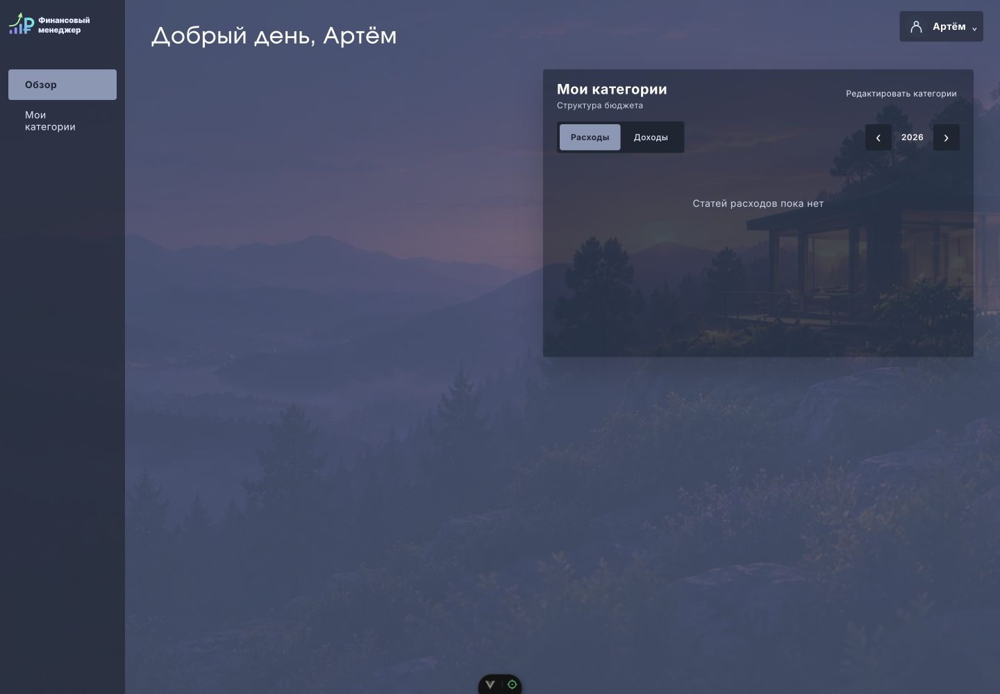
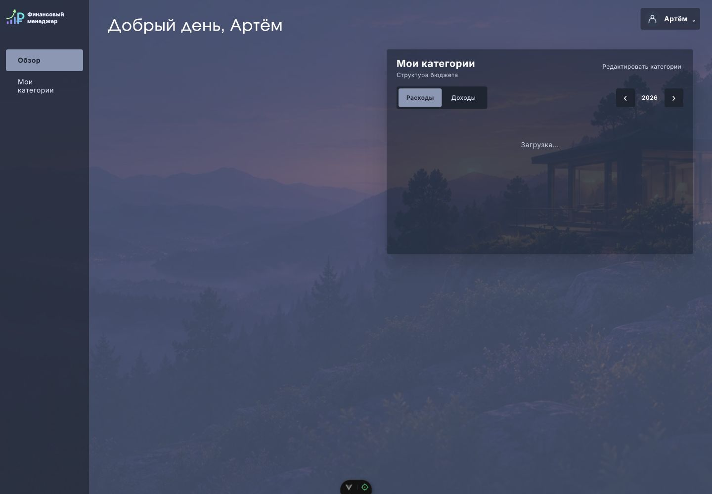
