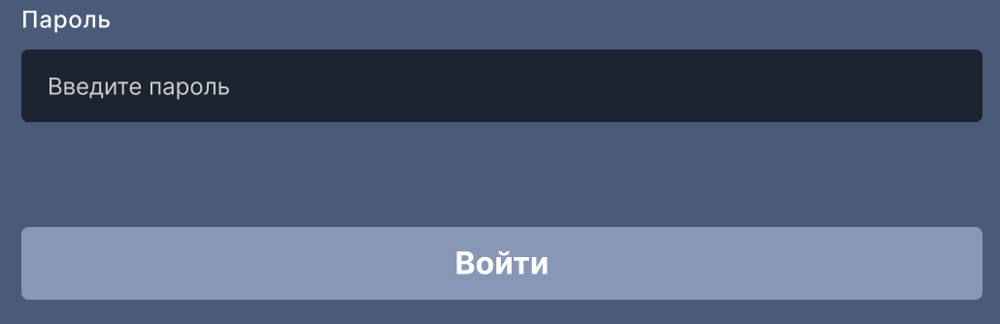
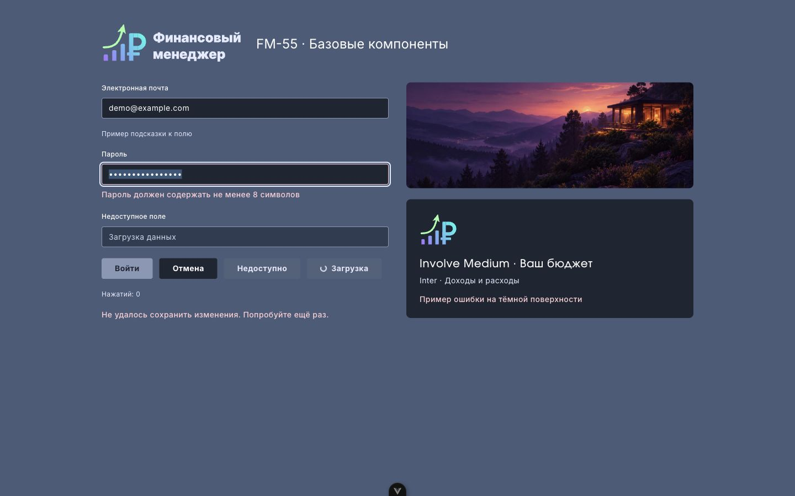
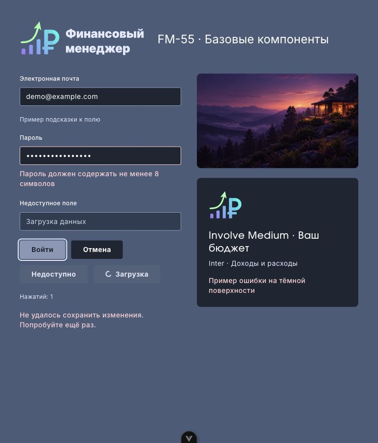
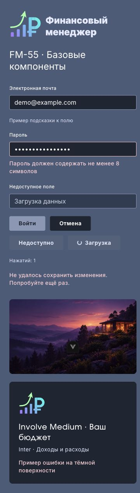

# Тема FM-55

Источник: [Figma, «Новый дизайн»](https://www.figma.com/design/FAPPJ3LrAUEY8indrAbfnV/Fin-Manager?node-id=255-1431), фрейм «Вход» 214:518. Свойства проверены в браузере; пользователь разрешил этот способ вместо недоступного Figma MCP.

| Роль | Токен | Источник / значение |
| --- | --- | --- |
| Фон страницы | `surface` | Rectangle 36 (214:520), #4A5C7A |
| Поле / тёмная поверхность | `field`, `surface-card` | Rectangle 40 (219:11), #1E2532 |
| Основная кнопка | `action` | Rectangle 41 (219:12), #8997B7 |
| Надпись кнопки | `action-foreground` | #1E2532, согласовано с пользователем вместо белого для контраста |
| Основной текст | `ink` | #FFFFFF |
| Вторичный текст / логотип | `ink-secondary` | #E5EAFF |
| Подпись поля | `text-caption font-medium` | Inter Medium 12px, трекинг 3%; «Пароль» 219:20 |
| Контролы | `h-control`, `min-h-control`, `rounded` | 37.5px; радиус 3.75px |

Hover, active, disabled, focus, error и placeholder дополняют базовые цвета семантическими токенами в `tailwind.config.js`. Отдельных макетов этих состояний нет. Текст ошибок и подсказок проверяется на контраст 4.5:1 на обеих поверхностях. Фокус имеет светлый контур с отступом; disabled не использует общую прозрачность; loading блокирует кнопку и показывает индикатор (учитывает reduced motion). На узком экране текст поля 16px, чтобы избежать автоматического увеличения при вводе на мобильных устройствах.

## Шрифты и ресурсы

- `font-sans`: Inter 400/500/600/700, латиница и кириллица из `@fontsource/inter`, локальная загрузка без внешнего CDN (OFL).
- `font-brand`: Involve Medium 500; оригинальный TTF и лицензия OFL находятся в `src/assets/fonts`. Источник: [официальный репозиторий StefanPeev/Involve](https://github.com/StefanPeev/Involve/tree/main/fonts/TTF). Файл не заменён другим шрифтом.
- `src/assets/new-design/landscape.webp`: исходное изображение 1672×941 извлечено из предоставленного `figma_fm.pdf`, конвертировано в WebP.
- `logo.svg`, `brand-mark.svg`: знак и надпись Group 35 (231:722) извлечены из того же PDF. Контуры сохранены; градиентные заливки содержат маленькие встроенные PNG из PDF. Фотография аватара и остальные экраны не включены.
- Изображения доступны через импорты Vite; также `main.css` объявляет `--fm-landscape`, `--fm-brand-logo`, `--fm-brand-mark`, поэтому ресурсы включаются в production-сборку. Для фона есть класс `bg-landscape`.

Для переходного AppLayout сохранён контраст неактивного меню; hover кнопки выхода использует светлый `ink` на тёмном фоне.

Совместимые имена `primary`, `sidebar` сохранены для существующих экранов. Перестройка экранов и их отдельных иконок относится к FM-56…FM-60; FM-55 поставляет общую тему, логотип и знак. Интерфейсы BaseInput, BaseButton и ErrorMessage сохранены. `aria-describedby` поля теперь объединяет внешнюю подсказку с ошибкой.

## Визуальная проверка

`npm run dev`, затем `/dev/theme-preview.html`: отдельная страница для проверки общих компонентов и ресурсов. Это стенд, не новый продуктовый экран; он не входит в production HTML entrypoints. Проверить ввод, Tab, disabled/loading и ширины 375, 768, 1440 CSS-px. Снимки и референс приведены в `docs/images`.

Проверено 14.10.2026 в Chrome: ввод и Enter работают, Tab пропускает disabled/loading, фокус виден на поле и кнопке. При ширинах 375, 768, 1440 нет горизонтального переполнения; ошибки переносятся. Production `/login` открывается без ошибок консоли. Все новые изображения и шрифты отдаются production-сервером с HTTP 200 и совпадают по размеру со сборкой.

Референс поля пароля и кнопки из PDF (цвет надписи кнопки изменён по согласованию):

| 1440 CSS-px | 768 CSS-px | 375 CSS-px |
| --- | --- | --- |
|  |  |  |
