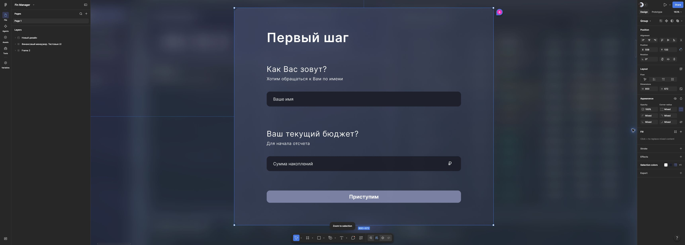
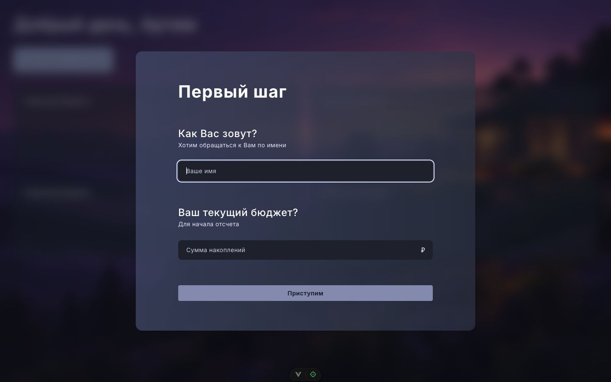
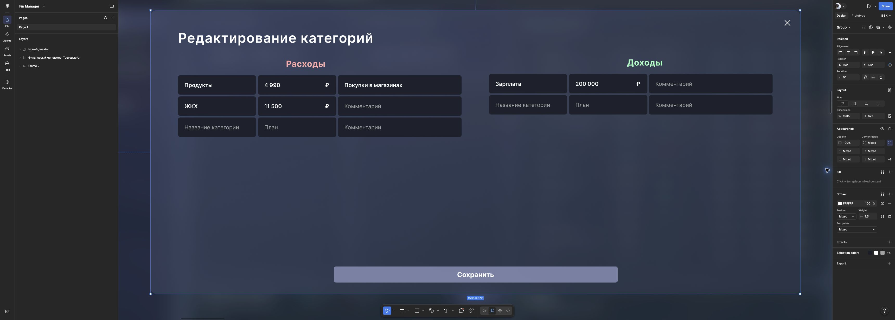
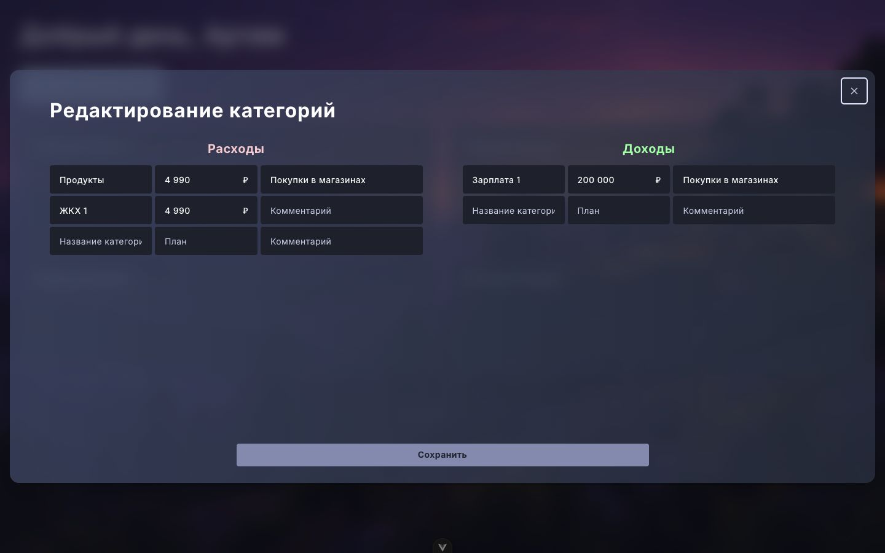
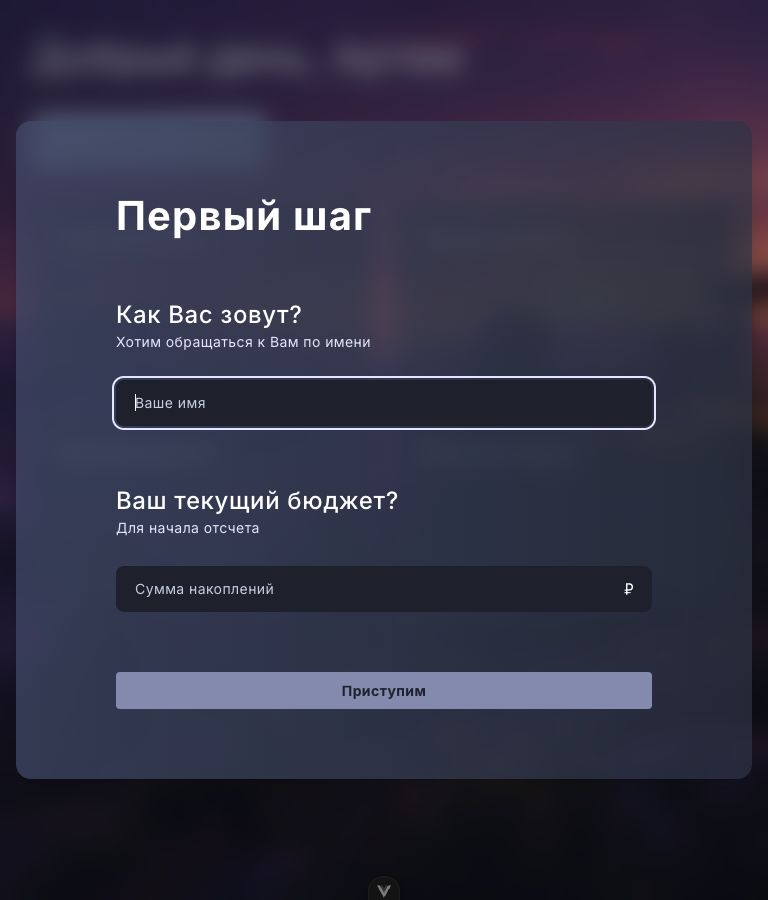
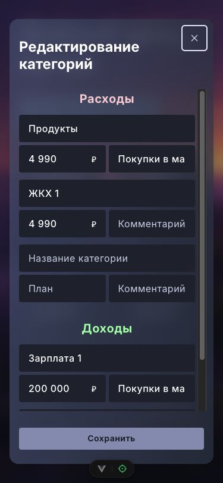
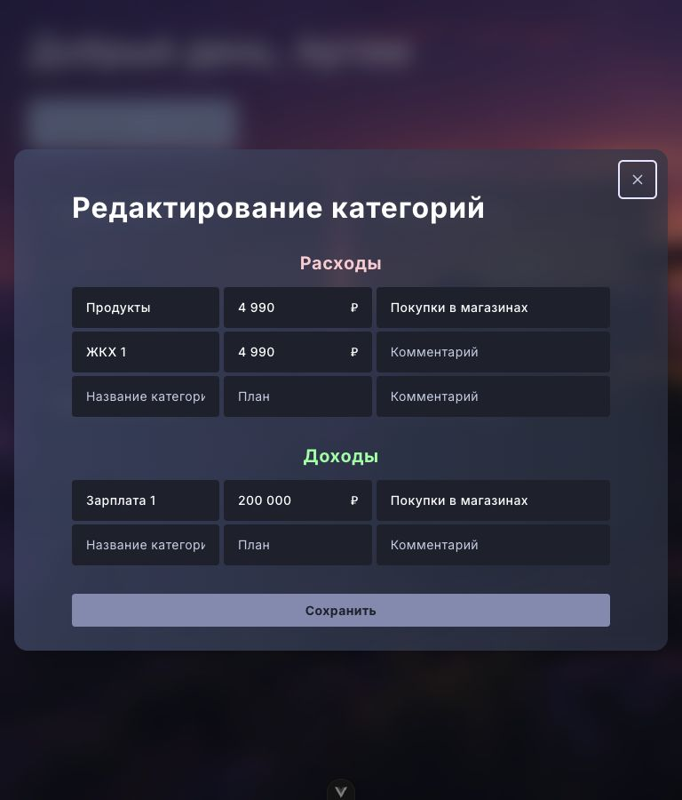
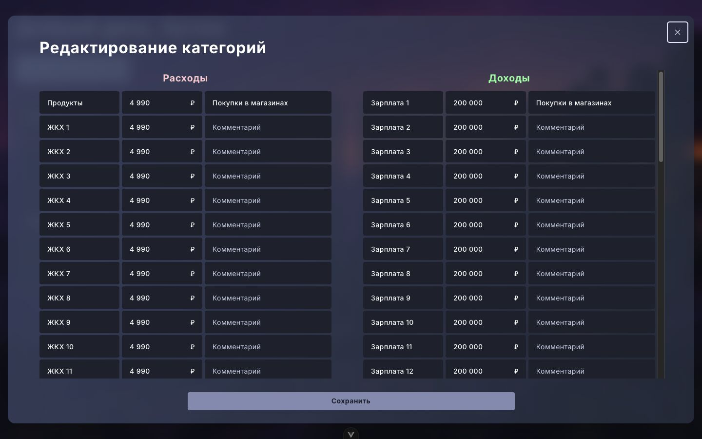
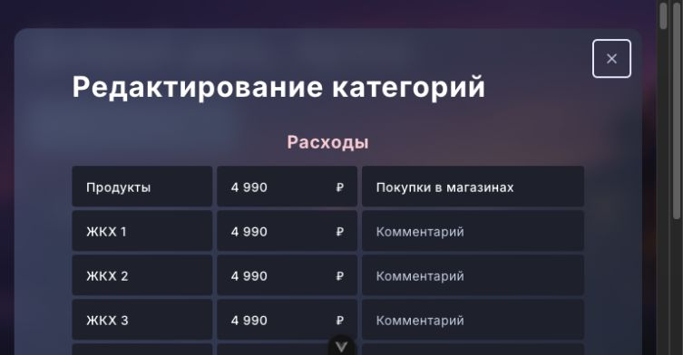

# FM-59 — окна нового дизайна

Макеты прочитаны в браузере (разрешённая пользователем замена Figma MCP): [Первый шаг, 220:322](https://www.figma.com/design/FAPPJ3LrAUEY8indrAbfnV/Fin-Manager?node-id=220-322), [Редактирование категорий, 234:954](https://www.figma.com/design/FAPPJ3LrAUEY8indrAbfnV/Fin-Manager?node-id=234-954).

Панель первого шага — 800×672, редактора — 1535×672; геометрия адаптируется к доступному экрану. У Rectangle 85 (221:328) радиус 15px, прозрачность 70%, градиент #465978 → #2F3D50; цвета вынесены в токены `dialog`. Поля используют тёмный `field`, кнопки — `action`. Текст кнопок остаётся контрастным тёмным по согласованию FM-55. Узкая раскладка, состояния ошибок/загрузки и ограничения прокрутки сохранены из предыдущей реализации, отдельных макетов для них нет.

Оба окна удерживают фокус при сохранении через readonly-поля; повторные запросы и частичный успех по-прежнему обрабатываются существующими composables. В первом шаге изменено центрирование: `my-auto` сохраняет доступ к верху высокого окна на низком экране. Возврат фокуса редактора проверен тестом. Фокусирование вызвавшей кнопки мышью в Safari до открытия окна добавляется отдельно в FM-58 (BudgetStructureCard).

Локальный стенд: `npm run dev`, `/dev/dialog-preview.html` (редактор), `?first` (первый шаг), `?long` (40 строк в колонке). Только тестовые данные и axios adapter, без запросов на сервер; стенд не входит в production entrypoints. Изменение данных на стенде возвращает сетевую ошибку для проверки сообщений.

Проверено в Chrome: ширины 375, 768, 1440 без горизонтального переполнения, ошибки полей видны; Tab с последней кнопки возвращается в начало обоих окон. На 768×400 верх окна доступен, подложка прокручивается до действий. При 40 строках и высоте 900 прокручиваются колонки, заголовок и кнопка остаются видимы. Частичный успех, повтор без дублирования и ограничения закрытия проверены автотестами.

| Макет | Реализация 1440 |
| --- | --- |
|  |  |
|  |  |

| 375 | 768 |
| --- | --- |
|  |  |
|  |  |

