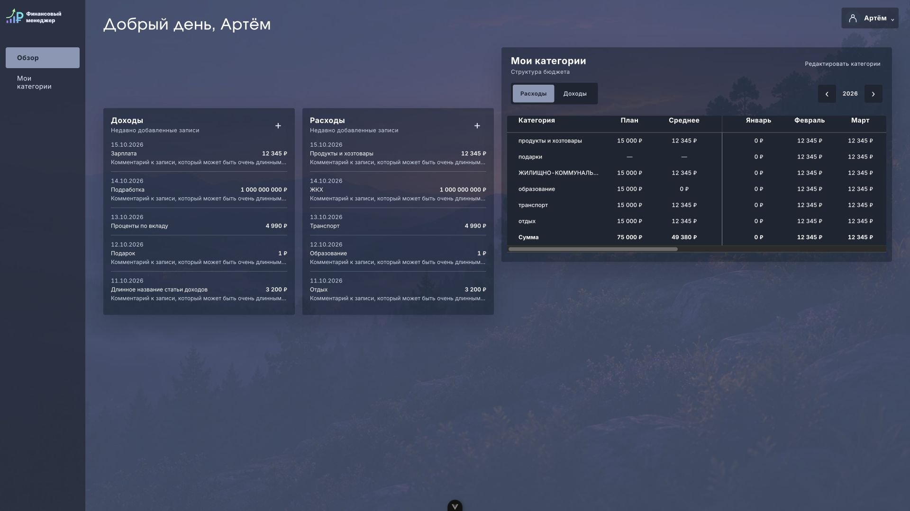
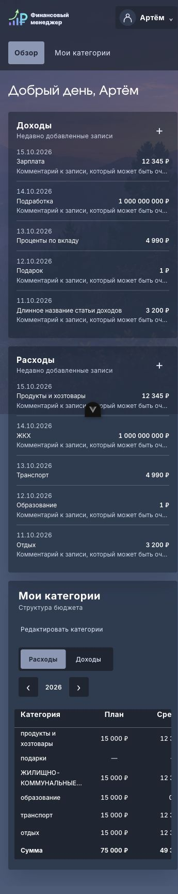

# FM-50: недавние записи

Источник: [Figma, «Новый дизайн», Главная 230:422](https://www.figma.com/design/FAPPJ3LrAUEY8indrAbfnV/Fin-Manager?node-id=230-422).
Макет прочитан через браузер по указанию пользователя (Figma MCP недоступен).
Карточка доходов: Rectangle 47, 230:588, 361×461, фон #010D17 с непрозрачностью 40%, радиус 5.
Используются токены текущей темы FM-55 и поверхность карточки FM-58.

Карточки стоят под резервом для «Суммы бюджета» / «Свободных средств», слева от категорий.
На 360px они идут одна под другой; от 640px — рядом, при двухколоночном экране 1280–1535px
снова одна под другой, чтобы не сжимать строки в узкой левой колонке; от 1536px — рядом.
Пустой резерв 112.5px (150px × 0.75 темы) есть только при двухколоночном экране.

В макете строки и состояния не нарисованы. По задаче строки адаптированы из «Моих категорий»:
дата ДД.ММ.ГГГГ, статья и сумма, ниже обрезанный комментарий. Полные тексты остаются в DOM и title.
Суммы — общий formatMoney; локальная дата API не переводится в UTC.
Высота растёт под пять записей, вместо обрезки последних строк. Пустое состояние, загрузка и ошибка
с кнопкой «Повторить» используют существующие компоненты и стили приложения.
Вид строк вынесен на согласование в PR:

API: GET /transactions, transaction_type=income|outcome, limit=5, sort=-transaction_date.
Серверный порядок сохранён. Каждый экземпляр независимо обрабатывает загрузку/ошибку;
устаревшие ответы и ошибки отбрасываются. Через template ref доступен reload(): Promise<void>.
«+» отдаёт событие add(type); открытие окна будет подключено в отдельной задаче.

Локальный стенд: /dev/transactions-preview.html, параметры ?empty, ?loading, ?error.
Данные синтетические, backend и токены не используются. Проверено в Chrome:
1920px и 360px, отсутствие горизонтального скролла страницы при 360px,
предельная сумма 1 млрд ₽, длинные тексты, пустое состояние, загрузка, ошибка и повтор,
переход Tab от «Добавить доход» к «Добавить расход».
