# FM-60: окно операции и проверка карточек

Источники прочитаны в Figma через браузер (MCP недоступен):
[«Новый дизайн»](https://www.figma.com/design/FAPPJ3LrAUEY8indrAbfnV/Fin-Manager?node-id=255-1431),
[«Главная» 230:422](https://www.figma.com/design/FAPPJ3LrAUEY8indrAbfnV/Fin-Manager?node-id=230-422),
[«Добавление расходов» 189:710](https://www.figma.com/design/FAPPJ3LrAUEY8indrAbfnV/Fin-Manager?node-id=189-710),
[окно 222:333](https://www.figma.com/design/FAPPJ3LrAUEY8indrAbfnV/Fin-Manager?node-id=222-333).

Окно Figma 800×672 приведено к масштабу общей темы 0,75: 600×504 CSS-px,
поля 65 → 48,75, верхний отступ 46 → 34,5, заголовок 32 → 24,
зазоры 5 → 3,75. Поля используют h-control (37,5 px) и общий радиус.
Текст полей на широком экране 14 × 0,75 = 10,5 px, на узком остаётся 16 px.
Цвета, Inter, кнопка сохранения и focus/error используют общие токены FM-55.
Полное название выбранной категории доступно в title; значение select и options сохранены.

Оба режима используют один компонент. Сохранены согласованные в FM-51 адаптации:
вертикальные поля на узком экране, нативные date/select, служебные состояния,
прокрутка строк при достаточной высоте, всего окна — при высоте меньше 540 px.
Цвет текста кнопки — контрастный из FM-55. Новых вариантов экранов не вводилось.
Карточки уже используют новую тему и строки FM-50; их разметка не менялась.
Размещение сохранено по FM-57: при 1440 px карточки друг под другом слева от таблицы,
при 768 px — рядом над таблицей, при 375 px — одна под другой.

## Проверка

Chrome, изолированный стенд /dev/transactions-preview.html?entry, синтетические данные.
На 375, 768, 1440 CSS-px проверены окно и обзор: горизонтального переполнения нет.
На широких экранах окно 600×504; на 375 px высота растёт под вертикальные поля.
Длинные названия и комментарии, сумма 1 млрд ₽ не выходят за карточки.
Проверены открытие обоих типов, ввод, сохранение, частичная ошибка и повтор оставшейся
строки, Escape, Tab/Shift+Tab с зацикливанием внутри окна и возврат фокуса на «+».
Проверены загрузка/ошибка/пустое состояние карточек и категорий.
Реальный backend не использовался. Автотесты проверяют отсутствие повторного POST
для сохранённых строк и обновление обеих карточек и таблицы по saved.

Три новых теста: полное имя выбранной категории и его сброс в обоих режимах (два),
доступный статус загрузки и фокус на закрытии (один). Первые два наблюдались красными
до добавления title; затем 328 тестов, ESLint и production build прошли.

## Сравнение окна

| Ширина | До | После |
| --- | --- | --- |
| 1440 | 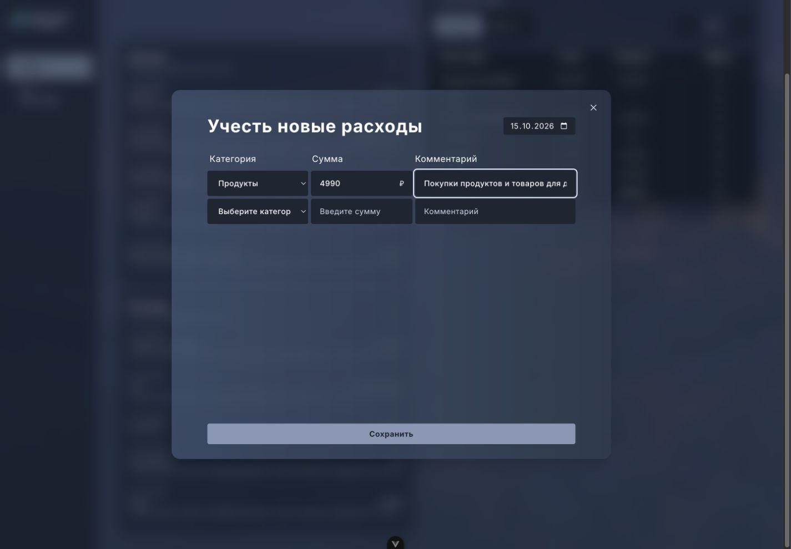 | 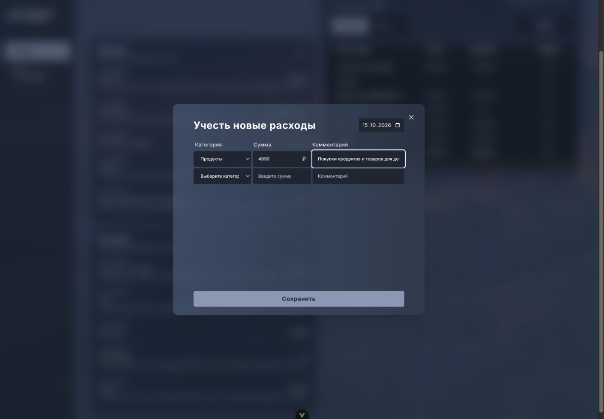 |
| 768 | 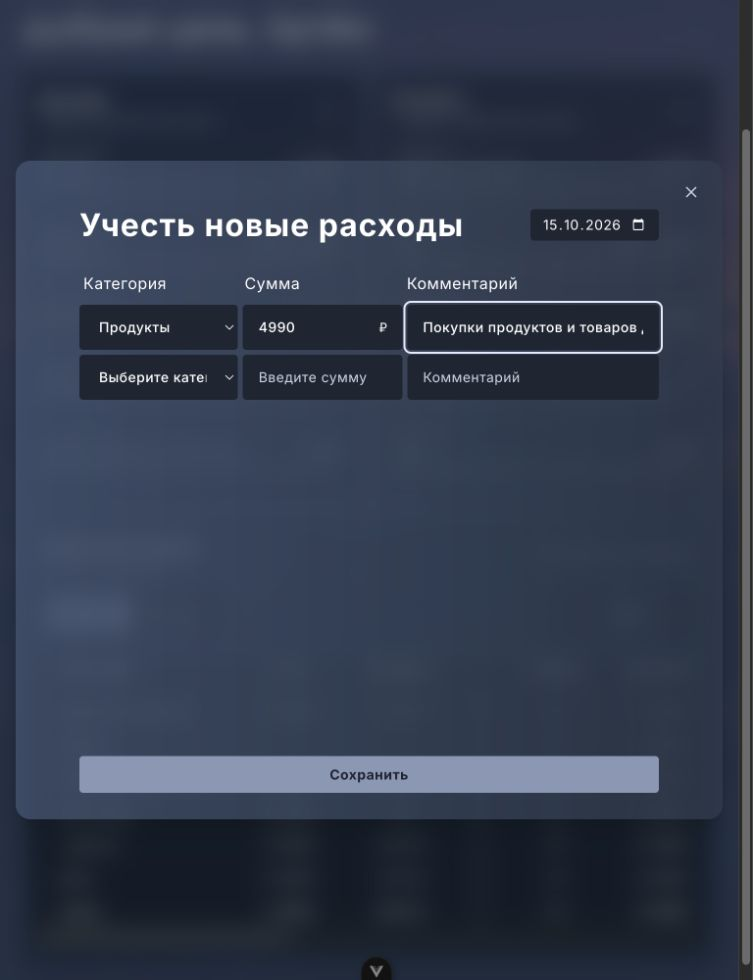 | 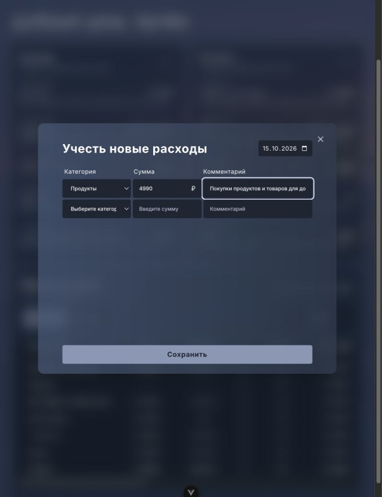 |
| 375 | 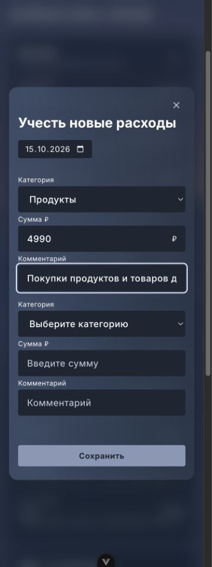 | 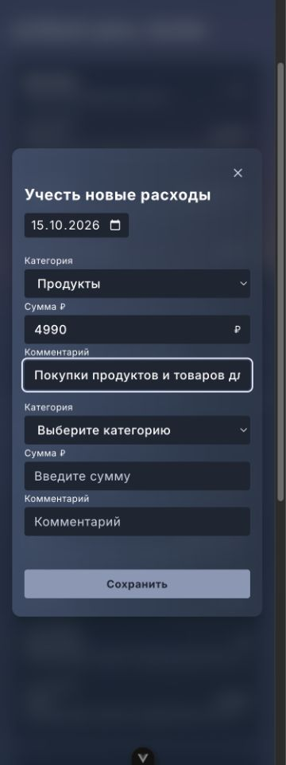 |

## Карточки и состояния

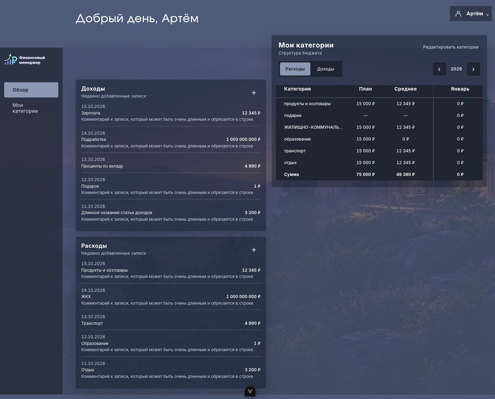
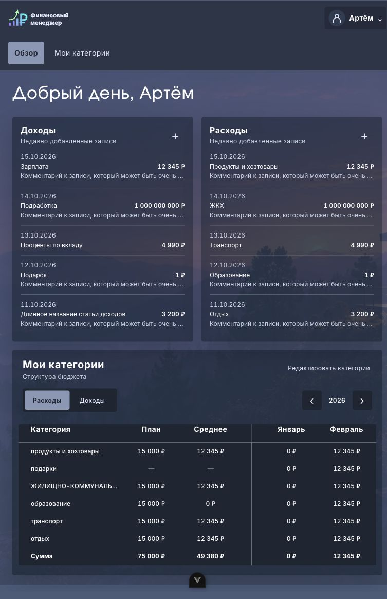
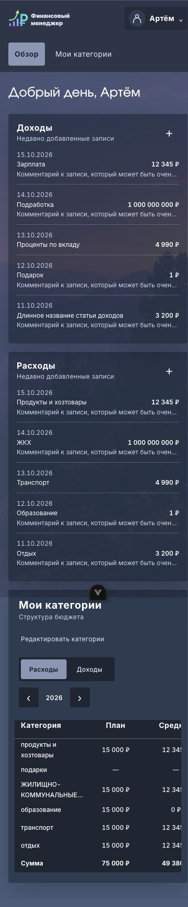
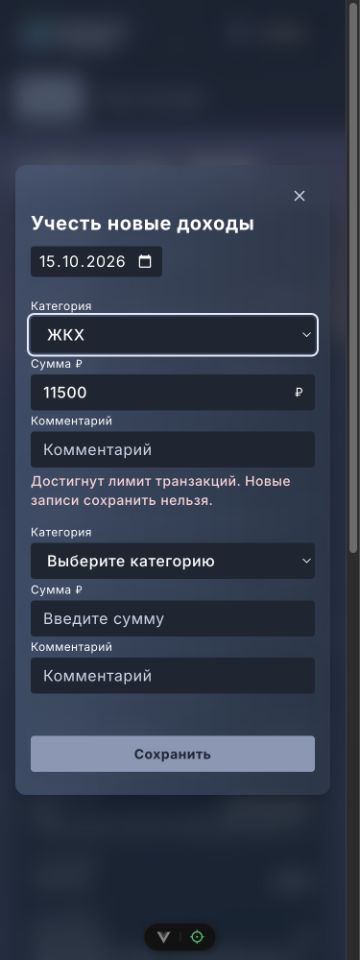
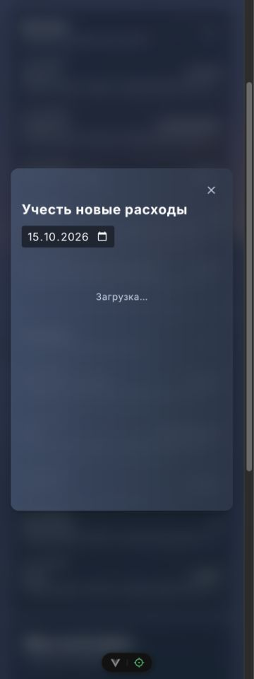
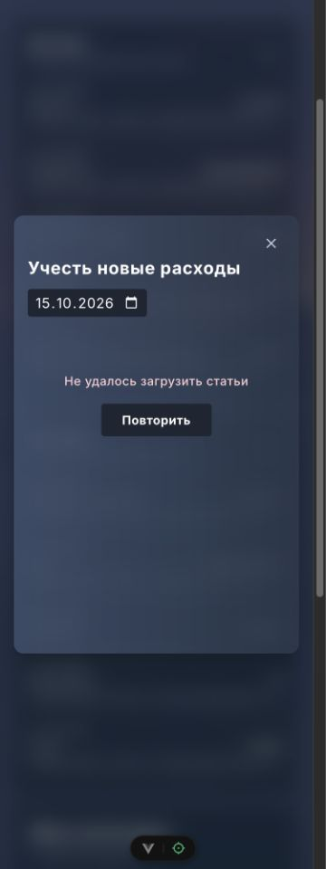
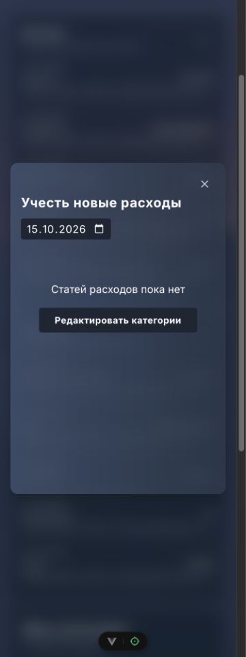
