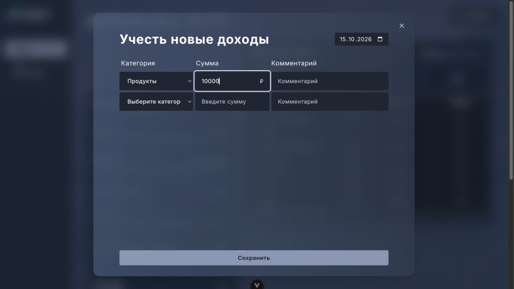
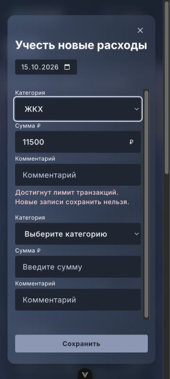

# FM-51: ввод расходов и доходов

Окно открывается кнопкой «+» соответствующей карточки. Категории загружаются по типу;
каждая заполненная строка сохраняется отдельным POST. Общая дата дополняется местным
временем на момент сохранения, без преобразования в UTC. При частичном успехе удаляются
только сохранённые строки; обе карточки и таблица бюджета обновляются и в этом случае.
Во время отправки поля заблокированы, повторное сохранение и закрытие недоступны,
как в редакторе категорий. После ответа можно повторить оставшиеся строки.

## Макет и адаптации

Источник: [Figma «Новый дизайн»](https://www.figma.com/design/FAPPJ3LrAUEY8indrAbfnV/?node-id=255-1431),
экспорт `screens/figma_fm.pdf` из fm-auto-dev, окно «Учесть новые расходы» на единственной странице.
Figma в браузере запросила вход; использован PDF-экспорт, прямо указанный в задаче.
Окно 800×672 px, внутренние поля 65 px, строки с колонками 184/185/292 px и зазором 5 px.
Цвета, шрифт и кнопка используют общую тему проекта. Дата — нативный date input
с системным календарём, подписи категорий — нативный select.

Пользователь согласовал 15 октября 2026: состояния загрузки, ошибки, отсутствия категорий
по существующему CategoryEditorDialog; на узком экране поля строки идут вертикально.
При высоте от 540 px прокручивается список строк, при меньшей высоте — всё окно.

## Проверка

Локальный изолированный стенд: `/dev/transactions-preview.html?entry`.
Ответы задаются axios adapter, запросов к backend нет. `&partial` возвращает лимит
для категории «ЖКХ»; `&noCategories`, `&categoryError`, `&categoryLoading` включают
соответствующие состояния.

В браузере проверены открытие расходов/доходов, добавление пустой строки, успешное
и частичное сохранение, переход из пустого состояния к редактору категорий,
Tab/Shift+Tab, Escape и восстановление фокуса. На 360×800 px окно читается,
горизонтальной прокрутки нет. Реальный backend в ручной проверке не использовался.

